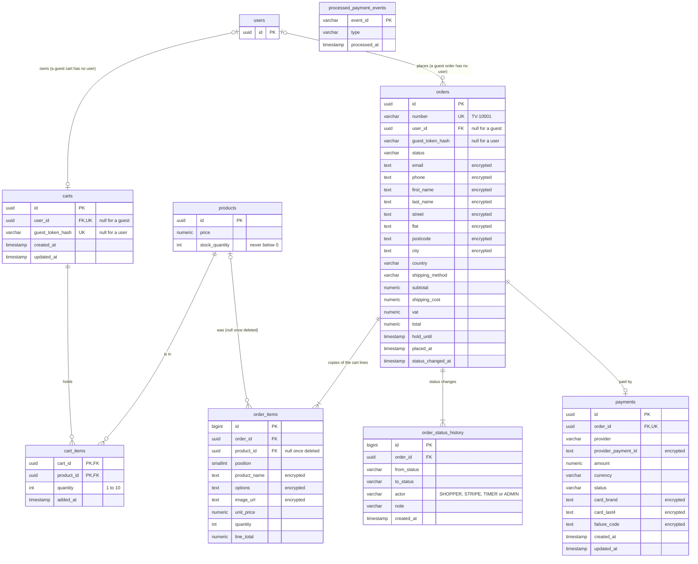
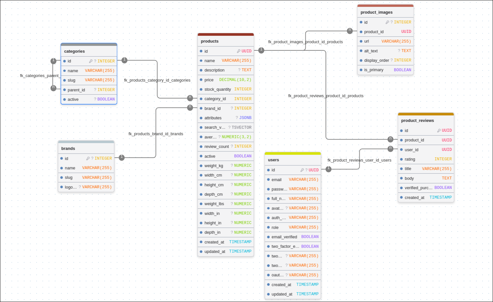

# i-love-shopping

An online shop (B2C e-commerce) for chess, Go and backgammon products. This is **Project 2 of 3:
the shopping cart, checkout, Stripe payments and order management.** It builds on Project 1
(accounts, login and the product catalog), which is described, folded away, at the
[end of this page](#project-1-accounts-login-and-the-catalog). The admin dashboard comes in Project 3.

The shop starts with about 1,770 real products (with photos and reviews), so there is something to
put in the cart right away. The assignment brief is in [docs/ASSIGNMENT2.md](docs/ASSIGNMENT2.md).

> **Reviewers:** every Project 2 checklist item is answered in **[REVIEW_ANSWERS.md](REVIEW_ANSWERS.md)**,
> with where to find it in the code and which tests prove it.

## Contents

1. [What you need](#what-you-need)
2. [Setup](#setup)
3. [What works](#what-works)
4. [Database](#database)
5. [How it works](#how-it-works)
6. [Usage guide](#usage-guide)
7. [Tests](#tests)
8. [Troubleshooting](#troubleshooting)
9. [Where things are](#where-things-are)
10. [Project 1: accounts, login and the catalog](#project-1-accounts-login-and-the-catalog)

---

## What you need

| To... | You need |
|---|---|
| Run the shop | **Docker** with Docker Compose (Docker Desktop on Windows and Mac; Docker Engine and the Compose plugin on Linux). Nothing else: Java, Node, the database, RabbitMQ and the Stripe CLI all run inside containers |
| Pay with a card | A free **Stripe account**, for two test keys. An email address is enough: no business details, no real card, and test mode moves no money. Without the keys the shop still runs, but placing an order says payments are unavailable |
| Run the automated tests | Docker running (the tests start their own database, Redis and RabbitMQ), plus **Java 21** and **Maven 3.9+** for the server tests and **[Bun](https://bun.sh)** for the website tests |
| Read the emails the shop sends | Nothing: they all land in MailHog, a test inbox at <http://localhost:8025> |

The brief allows "Docker and the payment simulation CLI". The Stripe CLI runs in its own container
here, so you don't install it.

---

## Setup

### 1. Get your Stripe test keys

1. Sign up at <https://dashboard.stripe.com/register>. Skip the "activate payments" business
   questions: test mode doesn't need them.
2. Make sure the dashboard is in **test mode** (the switch or "Sandbox" label at the top).
3. Open **Developers → API keys** (<https://dashboard.stripe.com/test/apikeys>). Under
   **Standard keys**, copy the **Publishable key** (`pk_test_...`), then click **Reveal test key** and
   copy the **Secret key** (`sk_test_...`).

Use the standard secret key, the one starting with `sk_test_`. A *restricted* key (`rk_test_...`)
doesn't work: Stripe refuses the CLI with a 403, so no payment is ever confirmed.

### 2. Put them in `.env`

```sh
cp .env.example .env
```

Open `.env` and fill in:

```sh
STRIPE_PUBLISHABLE_KEY=pk_test_...
STRIPE_SECRET_KEY=sk_test_...
```

Leave `STRIPE_WEBHOOK_SECRET` and `APP_ENCRYPTION_KEY` empty: the start script fills them in. Every
other setting works as it is.

### 3. Start

```sh
./start.sh
```

The first start takes a few minutes while everything is built. The script:
- writes a random **encryption key** into `.env` (`APP_ENCRYPTION_KEY`). Keep that file: orders saved
  with the key can't be read without it
- asks the Stripe CLI for its signing secret and saves it as `STRIPE_WEBHOOK_SECRET`, so the server
  trusts the payment results the CLI forwards
- builds and starts 7 containers

Then open:

| What | Where |
|---|---|
| The shop | <https://localhost:5443> (<http://localhost:5173> sends you there) |
| MailHog (every email the shop sends) | <http://localhost:8025> |
| RabbitMQ (the message queues) | <http://localhost:15672>, user `app`, password `changeme` |
| Stripe's payment events, as they arrive | `docker compose logs -f stripe-cli` |
| The API | <http://localhost:8080> |
| Database (PostgreSQL) | `localhost:5432`, database `iloveshopping`, user `app`, password `changeme` |

The shop uses a certificate made on your machine, not one from a certificate authority, so the
browser warns the first time. Choose **Advanced → Continue to localhost** (or **Accept the risk**)
once; the connection is still encrypted.

To check payments are wired up, run `docker compose ps stripe-cli`: it should say **Up**. If it says
*Exited*, see [Troubleshooting](#troubleshooting).

```sh
./start.sh down     # stop
./start.sh reset    # stop and wipe the database
```

Changed the Stripe keys later? Run `./start.sh` again: the website has to be rebuilt to pick up the
new publishable key.

---

## What works

**Cart**
- Each line shows the product's photo, name, options, price and quantity. The totals update as you
  add, remove or change quantities
- The cart is saved on the server. A guest's cart is kept for 30 days; a logged-in shopper's cart
  follows their account to any browser
- Logging in moves the guest cart into the account's cart. If both have the same item, the bigger
  quantity is kept (not the two added together)
- The server sets every price and checks the stock. Adding more than is in stock says how many are
  left; an item that sells out while in the cart is marked and left out of the total
- "Goes with your order": suggestions in the cart from the same game, sensibly priced

**Checkout**
- One page with contact, address, shipping options, the card and an order summary where quantities
  can still change or items be removed
- Every field is checked, in the browser and again on the server, with a message that says how to
  fix it
- Logged-in shoppers get their name and email from the account, and their phone and address from
  their last order
- The address is checked: the postcode must have the right format for the country, and for the
  biggest cities (Tallinn, Tartu, Riga, Vilnius, Helsinki and others) it must belong to the city
- After paying, an order confirmation page and a confirmation email

**Payments**
- Card payments through Stripe's test mode. The card is typed into Stripe's own form, so card
  details never reach this server. Stripe checks the card number, expiry date and CVC before paying
- The order becomes *Payment successful* or *Payment failed* only when Stripe's server tells ours
  (a signed webhook), never because the browser says so
- A declined card (not enough money, wrong number, expired) says why, and the shopper can try
  another card on the same order. If Stripe can't be reached, nothing is charged and the cart is kept
- Stripe's messages go through a **message queue** (RabbitMQ) to the part of the server that updates
  the order. A message that keeps failing is set aside in a *dead letter queue* instead of being lost
- Emails for a paid order, a declined payment, a cancellation and a refund. They go through a queue of
  their own, so a broken mail server never holds up a payment

**Orders**
- Placing an order reserves the stock straight away, so two people can never buy the last item
  twice. An unpaid order holds its items for 30 minutes, then they go back on sale
- The order keeps a copy of each item's name and price, so later price changes don't alter it
- *Your orders* on the account page: filter by status and date, sort, and open any order for its
  full details and status history
- Cancelling an order before it is packed: the items go back on sale at once and Stripe refunds the
  card. Once packing has started the server refuses (guests can cancel from their order page too)

**Security of the data**
- Names, contact details and addresses on orders, what was bought, and the payment records are
  **encrypted in the database** (AES-256-GCM). Someone with a copy of the database sees only scrambled
  text; the key is kept outside it, in `.env`
- The site runs on **HTTPS**; plain http only redirects there. The login cookie is only ever sent
  over the encrypted connection

**Extras beyond the brief**
- Refunds go all the way through Stripe, and are retried every minute if Stripe is down
- An unpaid order releases its items by itself after 30 minutes, and cancels the payment at Stripe
- If Stripe's message about a payment is lost, a job asks Stripe directly before releasing anything
- Cards that need a bank security check (3-D Secure) work
- The postcode is checked against the city, not just its format

**Not built yet**
- Project 3 is under way. Its screens are built in the website (the staff area under `/admin`, the
  help, contact, about and legal pages, the address book, the full cart page), but most of what they
  need from the server isn't yet. Where a server part is missing, the page says "The server can't do
  this yet". In the staff area, adding, editing and archiving products with their photos, and adding
  categories, work today
- Moving an order on to Processing, Shipped and Delivered isn't built yet on the server (the
  statuses and their rules are)
- Parcel tracking with a real courier.

---

## Database

PostgreSQL. The schema is created automatically on startup by numbered migration files
(`backend/src/main/resources/db/migration`, Project 2 is `V8` to `V10`).

The Project 2 tables, and how they connect to `users` and `products` from Project 1 (the Project 1
diagram is in the [Project 1 section](#project-1-accounts-login-and-the-catalog)):



| Table | Holds |
|---|---|
| `carts` | One cart per logged-in user, or per guest (found by a random cookie, stored only as a hash). Exactly one of the two is set |
| `cart_items` | A product and its quantity in a cart (1–10). No price: it is read fresh from `products` |
| `orders` | One order: who placed it, the delivery address (encrypted), shipping method, the money, its status, and until when its items are held |
| `order_items` | A copy of each cart line at the moment of ordering: name and photo (encrypted), price and quantity |
| `order_status_history` | Every status change: from, to, who made it (shopper, Stripe, timer, admin) and when |
| `payments` | The Stripe payment behind an order, its card brand and last 4 digits once paid (encrypted), and where a refund stands. Never the card number |
| `processed_payment_events` | Stripe events already handled, so one sent twice is applied once |

**Order statuses.** *Pending payment* → *Payment successful* or *Payment failed* (Stripe decides) →
*Processing* → *Shipped* → *Delivered*. A paid order can become *Cancelled* and then *Refunded*; an
unpaid one becomes *Cancelled* when its 30 minutes run out. Every allowed move, and who may make
it, is in [claude-docs/ORDER_STATES.md](claude-docs/ORDER_STATES.md).

**Encrypted columns.** Marked *encrypted* in the diagram. Ids, statuses, dates, money and the country
stay readable, because the database filters and sorts by them, and encrypted text can't be searched.

---

## How it works

| Part | Technology |
|---|---|
| Website | React 18, TypeScript, Vite. Redux Toolkit and React Query for state, Axios for requests, Stripe.js for the card form |
| Server | Java 21, Spring Boot 4, Spring Security, stripe-java |
| Database | PostgreSQL 16, with the schema managed by Flyway |
| Sessions | Redis 7 |
| Message queue | RabbitMQ 4 |
| Email (development) | MailHog |
| Payments | Stripe (test mode), with the Stripe CLI forwarding its webhooks |
| Everything runs in | Docker Compose: 7 containers (website, server, database, Redis, RabbitMQ, MailHog, Stripe CLI) |

The server is one application split into areas: **users**, **login**, **catalog**, **cart**,
**orders** and **payments**. Each area has its own code and talks to the others only through a
small interface, so an area could be split out into its own service later if it ever needs to scale
on its own.

**The cart.** A guest's cart is found by a random token in a cookie JavaScript can't read; the
database keeps only a hash of it. A logged-in shopper's cart belongs to their account. Prices are
never stored in the cart: they are read from the products every time, so the cart can't show an old
price.

**Placing an order.** In one database transaction the server takes the stock for every item, copies
the cart into the order, and empties those lines from the cart. Stock is taken with a single
"take it only if there's enough" update, so when two people buy the last item at the same moment,
exactly one succeeds and the other is told it sold out. If any item is short, the whole order is
undone.

**Paying (Stripe).** The server asks Stripe for a payment for the order's total. The browser shows
Stripe's card form, which sends the card straight to Stripe, and Stripe tells our server the result
by calling its webhook. The server checks that call's signature, so a fake "paid" message is
rejected. If the webhook is lost, a job that runs every minute asks Stripe directly before releasing
an unpaid order's items.

**The message queue.** The webhook only checks the signature, puts the payment's result on a RabbitMQ
queue and answers Stripe at once. A separate listener takes it off the queue and, in one database
transaction, updates the order, its stock and its history. Each Stripe message is applied once, even
if it arrives twice. If applying it fails, it is retried twice more; after that it is moved to a
*dead letter queue*, where it waits to be looked at and moved back, instead of being lost or retried
forever.

**Emails.** Only after that transaction has saved does the server put "this order needs an email" on a
second queue, so nobody gets an email about a change that didn't happen. A second listener writes the
email from the order and sends it. If the mail server is down, the email is retried and then waits in
its own dead letter queue, while payments carry on.

**Cancelling and refunds.** A paid order can be cancelled until packing starts. In one transaction the
order becomes *Cancelled* and its stock goes back on sale; then the server asks Stripe for the refund.
When Stripe confirms it, the order becomes *Refunded*. If Stripe can't be reached, the order stays
cancelled and a job asks Stripe again every minute. Each refund is sent with the order's own id as a
key, so asking twice never refunds twice.

**Encryption in the database.** Before an order is saved, its personal and payment details are
encrypted with AES-256-GCM, each value with a fresh random starting value, so the same address saved
twice looks different both times, and a changed byte is detected instead of decrypted to nonsense.
The key comes from `.env` and is never in the code or the database.

**HTTPS.** The website container (nginx) serves the site over TLS 1.2 or 1.3 with a certificate it
makes on first start. Plain http only redirects to https.

---

## Usage guide

What each checklist item should show is in [REVIEW_ANSWERS.md](REVIEW_ANSWERS.md).

### In the website

| Try this | Where |
|---|---|
| Add to cart, change quantities, see suggestions | Any product page, then the cart in the header |
| Ask for more than is in stock | A product page that says *Only N left*: raise its quantity in the cart past N, and the cart says how many are left |
| Keep a cart as a guest, then log in | Add items logged out, then log in: they move into the account's cart |
| Check out | The cart → **Checkout** (as a guest or logged in) |
| See prefilled details | Log in, place one order, then start another: phone and address are filled in |
| See the address check | Checkout with city `Tallinn` and postcode `50090` (a Tartu postcode) |
| Pay, and see a declined card | Checkout with a test card from the table below |
| The emails for paid, declined, cancelled, refunded | [MailHog](http://localhost:8025) |
| Your orders, filters, sorting, order details | `/account/orders`, while logged in |
| Cancel an order and get a refund | Open a paid order → **Cancel order**. Watch the product's stock go back up |

### Test cards

Any future expiry date, any CVC, any postcode:

| Card number | What happens |
|---|---|
| `4242 4242 4242 4242` | Paid |
| `4000 0025 0000 3155` | The bank asks for a security check (3-D Secure) first, then paid |
| `4000 0000 0000 9995` | Declined: not enough money |
| `4000 0000 0000 0069` | Declined: expired card |
| `4000 0000 0000 0127` | Declined: wrong CVC |
| `4242 4242 4242 4241` | Stripe's form says the number is wrong, before anything is sent |

After a declined card the order page offers **Try another card** for the same order. Payments and
refunds show under **Payments** in the Stripe dashboard (test mode).

### Seeing the encryption

Place an order, then look at the table directly:

```sh
docker compose exec postgres psql -U app -d iloveshopping \
  -c "SELECT number, first_name, street, city, total FROM orders ORDER BY placed_at DESC LIMIT 3"
```

The names and addresses show as `v1:` followed by scrambled text, while the order number and total
are readable. The same order on the website shows the real address.

For the connection, open <https://localhost:5443> and click the padlock (or "Not secure") next to the
address: the connection is TLS. From a terminal, `curl -kIv https://localhost:5443 2>&1 | grep -E "SSL connection|HTTP/"`
shows the same, and `curl -I http://localhost:5173` shows the redirect to https.

Any database tool works too (VS Code's SQLTools, DBeaver, pgAdmin): host `localhost`, port `5432`,
database `iloveshopping`, user `app`, password `changeme`.

### Seeing the queues

Open RabbitMQ at <http://localhost:15672> → **Queues**. `orders.payment-events` takes Stripe's results,
`orders.emails` the emails, and each has a `.dlq` (dead letter queue) beside it.

- **A bad message set aside:** open `orders.payment-events` → **Publish message**, type `not json` as
  the payload, publish, and after a few seconds it appears in `orders.payment-events.dlq`.
- **An email waiting out a mail server failure:** run `docker compose stop mailhog`, pay an order, and
  the email lands in `orders.emails.dlq`. Run `docker compose start mailhog`, open that queue →
  **Move messages** to `orders.emails`, and it arrives.

### The API

The website covers everything; these are the Project 2 endpoints behind it.

| Endpoint | Does |
|---|---|
| `GET /cart`, `POST /cart/items`, `PUT/DELETE /cart/items/{productId}` | The cart (guests too, by cookie) |
| `POST /cart/merge` | Move the guest cart into the account's (logged in) |
| `POST /orders`, `GET /orders/{id}` | Place an order from the cart, read it (guests too) |
| `POST /orders/{id}/payment` | Pay a declined order again with another card |
| `POST /orders/{id}/cancel` | Cancel a paid order before packing, with a refund (guests too) |
| `GET /orders?status=&from=&to=&sort=&page=` | Your orders, filtered and sorted (logged in) |
| `GET /orders/last-delivery` | The phone and address of your last order, for the checkout (logged in) |
| `POST /payments/webhook` | Where Stripe reports payments (checked by signature) |

---

## Tests

Needs Docker running, Java 21 and Maven for the server, Bun for the website (see
[What you need](#what-you-need)). The shop doesn't have to be running.

```sh
cd backend && mvn verify       # server: 316 tests, a few minutes
cd frontend && bunx vitest run # website: 75 tests, seconds
```

**Latest run (2026-10-08): 391 tests, all passing.** Server tests run against a real PostgreSQL,
Redis and RabbitMQ that the tests start themselves. Stripe and the mail server are replaced by
stand-ins, so the tests don't need your Stripe keys or the internet.

What the brief asks for, and where it is:

| The brief asks for | Tests |
|---|---|
| Unit: cart functionality | `CartServiceTest` (totals, short and sold-out lines, the limit of 10), `CartPanel.test.tsx` |
| Unit: order summary calculations | `OrderTotalsTest` (subtotal, shipping, free shipping from €100, VAT rounding), `shipping.test.ts` |
| Flow: registration | `AuthControllerIT` (`register_succeeds_thenDuplicateEmailConflicts`, `register_withInvalidBody_returns400WithFieldErrors`), `RegisterPage.test.tsx` |
| Flow: checkout, guest and logged in | `OrderIT` (`aGuestOrder_reservesTheStock_copiesTheCart_andEmptiesIt`, `aSignedInCheckout_goesFromCartToPaid_onlyWhenStripeSaysSo`), `CheckoutPage.test.tsx` |
| Manual: encryption in transit and at rest | [Seeing the encryption](#seeing-the-encryption), plus `EncryptionIT` |

Some tests exist to prove the hard cases: two buyers racing for the last item, the same Stripe
message twice, a forged webhook, Stripe being unreachable, a message that can never be read ending in
the dead letter queue, a double-clicked Cancel refunding once, and the database holding only
encrypted text. How the tests are organised is in [backend/README.md](backend/README.md#tests) and
[frontend/README.md](frontend/README.md#tests).

---

## Troubleshooting

- **Pay says payments are unavailable, or the card form says it isn't set up:** the Stripe keys are
  missing from `.env`. Add them and run `./start.sh` again (the website has to be rebuilt).
- **`stripe-cli` says *Exited*, or the order page keeps saying "Confirming your payment":** the
  Stripe CLI isn't forwarding. Run `docker compose logs stripe-cli`. A `403` with
  `more_permissions_required` means `STRIPE_SECRET_KEY` is a restricted key (`rk_test_...`): put the
  standard secret key (`sk_test_...`) in its place and run `./start.sh` again.
- **A database tool says `password authentication failed for user "app"`:** the password is
  `changeme`. The database keeps the password it was created with, so if you changed
  `POSTGRES_PASSWORD` after the first start, either use the old one or run `./start.sh reset`.
- **The browser warns the site isn't secure:** expected once, see [Setup](#3-start). The certificate is
  made on your machine rather than by a certificate authority; the connection is still encrypted.
- **`docker compose` says `APP_ENCRYPTION_KEY` is missing:** run `./start.sh` once. It makes the key.
- **Orders fail to open after changing `.env`:** the encryption key changed. Put the old one back, or
  run `./start.sh reset` to start over with an empty database.
- **Port already in use:** change `FRONTEND_PORT`, `FRONTEND_HTTPS_PORT` or `BACKEND_PORT` in `.env`
  and start again.
- **Server won't start after an update:** run `./start.sh reset` to start with a fresh database.
- **No email arrives:** emails never leave your machine; they all appear in MailHog. If MailHog was
  down, the email waits in the `orders.emails.dlq` queue in RabbitMQ (see
  [Seeing the queues](#seeing-the-queues)).
- **Can't stay logged in:** open the site at `localhost`, not your computer's network IP.

---

## Where things are

| Folder or file | What it is |
|---|---|
| [backend/](backend/README.md) | The server. Its README maps every feature to the file that handles it, and explains the tests |
| [frontend/](frontend/README.md) | The website. Its README lists the pages, folders and tests |
| [tools/catalog-import/](tools/catalog-import/README.md) | The Python scripts that build the demo catalog |
| [REVIEW_ANSWERS.md](REVIEW_ANSWERS.md) | Answers to the review checklist, with code and test references |
| [docs/](docs/) | The assignment briefs and the Project 1 ERD image |
| `rabbitmq/` | Which RabbitMQ plugins are on (the management page and Move messages) |
| `CLAUDE.md`, `claude-docs/`, `.claude/` | Instructions and notes for Claude Code, the AI assistant used while building this |
| `homework/` | The author's study notes for the topics in this project |
| `start.sh`, `docker-compose.yml`, `.env.example` | Startup script, container setup, and the list of settings |

---

## Project 1: accounts, login and the catalog

Project 1 is finished and everything in it still works. Its brief is in
[docs/ASSIGNMENT.md](docs/ASSIGNMENT.md) and its review answers are at the end of
[REVIEW_ANSWERS.md](REVIEW_ANSWERS.md).

<details>
<summary><b>Show Project 1</b>: what works, its database diagram, how login and search work, two-factor setup, Google keys, admin and API</summary>

### What works in Project 1

**Accounts and security**
- Sign up and log in with email and password, or with Google
- CAPTCHA on sign-up (off by default; turn on with `RECAPTCHA_ENABLED=true` and your keys in `.env`)
- Password reset by email
- Optional two-factor login (authenticator app, plus 8 one-time backup codes)
- Short-lived access tokens kept only in memory, refresh tokens in a cookie JavaScript cannot read
- Each refresh token works exactly once; reusing an old one is rejected
- Logout invalidates both tokens; a password reset logs out every device
- Rate limiting on login, sign-up and search

**Catalog**
- Categories you can browse level by level, starting from the four games
- Search with filters for category, brand, price and rating, and suggestions while you type
- Tolerates typos (`stanton` still finds Staunton sets)
- Sorting by relevance, price, rating and newest
- Product pages with photos, specs in metric and imperial, colour/size options and reviews
- Admins can add, edit and delete products and upload images

**Not built yet:** deleting your own review from the website (the API supports it).

### Project 1 database



| Table | Holds |
|---|---|
| `users` | Accounts: email, password hash, name, role, login provider, 2FA settings |
| `categories` | The category tree; each category can have a parent |
| `brands` | Product brands |
| `products` | Name, description, price, stock, category, brand, weight and size in both unit systems, extra attributes, average rating |
| `product_images` | Photos of a product, in display order |
| `product_reviews` | A 1–5 star rating and text; one review per user per product |

Login sessions (refresh tokens, logged-out tokens, pending 2FA) are kept in **Redis**, not in the
database, and expire on their own.

**Where the product data comes from.** The products are real listings from three chess, Go and
backgammon suppliers. A few **Python scripts** in [tools/catalog-import](tools/catalog-import/README.md)
download the suppliers' product pages and turn them into one SQL file, which the database loads on
startup. The scripts are a one-off tool the developer runs by hand, not part of the shop, and the
finished SQL file is committed, so **you don't need Python to run the project**.

### How login works

**Login tokens (JWT).** Logging in returns two tokens. The *access token* is a signed JWT (library:
jjwt) that lasts 15 minutes and holds only the user id and role, no personal data. The website keeps
it in memory only, never in browser storage. The *refresh token* lasts 7 days and sits in an
`httpOnly` cookie that JavaScript can't read. After a page reload, the website uses the refresh
token to get a new access token.

**Single-use refresh tokens.** Every refresh swaps the old refresh token for a new one in Redis in
one atomic step (a small Lua script), so the same token can never be used twice, even by two
requests at the same moment.

**Logout.** The access token's id goes on a blocklist in Redis until the token would have expired
anyway, and the refresh token is deleted.

**Two-factor login (TOTP).** The standard authenticator-app method (library: `dev.samstevens.totp`).
The server creates a secret, the website shows it as a QR code, and the app then shows a new 6-digit
code every 30 seconds. After 2FA is on, logging in takes the password *and* a current code.

**CAPTCHA.** Google reCAPTCHA on sign-up. The server checks the CAPTCHA token with Google before
creating the account.

**Google login.** The website gets an ID token from Google, and the server checks that token's
signature against Google's public keys before logging the user in.

**Password reset.** The server emails a one-time link that expires. Using it sets the new password
and logs the account out everywhere.

**Validation.** Forms are checked in the browser for quick feedback, and every request is checked
again on the server, because the browser checks can be bypassed.

**Image upload.** The server checks the file's actual contents, not its name, to confirm it's a
JPEG or PNG. It then re-saves the image, which strips anything hidden inside it, and stores it under
a random name.

### Search

Search uses PostgreSQL's built-in full-text search, so no separate search engine is needed.

- **Matching.** Every product has a pre-built search index made from its name, description and
  attributes (such as wood type). A match in the name ranks above a match in the description.
- **Typos.** If nothing matches exactly, the search falls back to "similar-looking" names
  (the `pg_trgm` extension), so `stanton` still finds Staunton sets. The page says when it did this.
- **Filters.** Results can be narrowed by category, brand, price range and rating. Each filter shows
  how many results it would leave.
- **Sorting.** By relevance, price, rating or newest.
- **Suggestions.** Product names appear while you type, from 2 characters on.
- **Speed.** Indexes keep searches fast. They were tested on 50,000 products.

Search is behind one interface in the code, so it can be swapped for a dedicated search engine
(such as Elasticsearch) later without changing anything else.

### Trying Project 1 in the website

| Try this | Where |
|---|---|
| Browse, filter and sort | `/catalog`: pick a category, brand, price or rating, change the sort |
| Search with suggestions | Search box in the header: type `wal` |
| Create an account | `/register` |
| Reset your password | `/login` → *Forgot your password?*, then open the email in [MailHog](http://localhost:8025) |
| Turn on two-factor login | `/account` (see below) |
| Write a review | Any product page, while logged in |

### Setting up two-factor login

First, on the website:
1. Log in and open `/account`.
2. Type your password and click **Set up two-factor**. A QR code and a long **setup key** appear.

Then add it to an app on your phone. Pick **one** of these:

*Option A: Google Authenticator or Authy (easiest)*
1. Install the app from the App Store or Google Play.
2. Open the app and tap **+** → **Scan a QR code**.
3. Scan the QR code on the screen. An entry called **i-love-shopping** appears with a 6-digit code.

*Option B: the Passwords app on an iPhone (no install)*

Scanning with the camera alone won't work: the Passwords app needs a saved entry for the site
first, and it has none for this one.
1. Open **Passwords** and tap **+** to add a new entry.
2. Set **Website** to `localhost`, **User name** to your email, and **Password** to your password.
   Save.
3. Open that entry, tap **Edit** → **Set Up Verification Code**.
4. Choose **Scan QR Code** and scan the screen, or choose **Enter Setup Key** and type the long key.
5. The entry now shows a 6-digit code.

Finish on the website:
1. Type the **6-digit code** from your phone into the box. Don't type the long setup key there.
   The code changes every 30 seconds, so use the current one.
2. Click **Turn on two-factor**.
3. Write down the 8 backup codes. They are shown only once. Each one works once if you lose your
   phone.

From then on, logging in asks for the current 6-digit code after your password.

### Needs your own Google keys

CAPTCHA and Google login are built, but they're switched off by default so the project runs without
any Google accounts or keys. Both need a (free) Google account. The keys go into `.env`.

**CAPTCHA on sign-up**
1. Go to <https://www.google.com/recaptcha/admin/create> and sign in with Google.
2. Fill in the form:
   - **Label:** anything, e.g. `i-love-shopping`
   - **reCAPTCHA type:** **Challenge (v2)** → **"I'm not a robot" Checkbox**
   - **Domains:** `localhost`
3. Click **Submit**. The next page shows a **Site key** and a **Secret key**.
4. Open `.env` and set:
   ```sh
   RECAPTCHA_ENABLED=true
   RECAPTCHA_SITE_KEY=<the site key>
   RECAPTCHA_SECRET_KEY=<the secret key>
   ```

**Sign in with Google**
1. Go to <https://console.cloud.google.com> and sign in. At the top, open the project picker →
   **New project**, name it anything, and create it.
2. In the search bar, open **Google Auth Platform** and click **Get started**. Enter an app name and
   your email, choose **External**, and finish the steps.
3. Under **Audience** → **Test users**, add the Google account you'll log in with. While the app is in
   testing, only these accounts can sign in.
4. Under **Clients** → **Create client**:
   - **Application type:** **Web application**
   - **Authorised JavaScript origins:** add `https://localhost:5443` (and `http://localhost:5173` if
     you also run the website with `bun run dev`)
   - Leave **Authorised redirect URIs** empty.
5. Click **Create** and copy the **Client ID** (it ends in `.apps.googleusercontent.com`). You don't
   need the client secret.
6. Open `.env` and set:
   ```sh
   GOOGLE_CLIENT_ID=<the client ID>
   ```
   A new client can take a few minutes to start working.

**Then restart the project**

Run `./start.sh`. It rebuilds the website with the new keys, and a restart without the rebuild isn't
enough. Open the site at `https://localhost:5443`, not `127.0.0.1`, because Google only accepts the
addresses you registered. The CAPTCHA box then appears on `/register`, and the **Sign in with
Google** button on `/login`.

If you'd rather skip this, the automated tests still cover both features (`CaptchaServiceTest`,
`GoogleTokenVerifierTest`).

### Becoming an admin

There is no admin sign-up on purpose. Create a normal account, then promote it:

```sh
docker compose exec postgres psql -U app -d iloveshopping \
  -c "UPDATE users SET role = 'ADMIN' WHERE email = 'you@example.com'"
```

Log in again to get admin rights.

### Project 1 API

Some things can only be done through the API, like admin actions and checking by hand that an old
refresh token is rejected.

```sh
# log in: the response body has the access token, the refresh token comes back as a cookie
curl -i -X POST http://localhost:8080/auth/login \
  -H 'Content-Type: application/json' \
  -d '{"email":"you@example.com","password":"your password"}'

# get a new access token; run it twice with the same cookie and the second call is rejected
curl -i -X POST http://localhost:8080/auth/refresh -b 'refresh_token=<cookie value>'

# search
curl 'http://localhost:8080/products?q=walnut&minPrice=25&maxPrice=100&sort=price_asc'
```

| Endpoint | Does |
|---|---|
| `POST /auth/register`, `/auth/login`, `/auth/logout`, `/auth/refresh` | Sign up, log in, log out, renew the session |
| `POST /auth/forgot-password`, `/auth/reset-password` | Password reset |
| `POST /auth/2fa/setup`, `/auth/2fa/enable`, `/auth/2fa/login` | Two-factor login |
| `POST /auth/oauth/google` | Log in with Google (needs `GOOGLE_CLIENT_ID` in `.env`) |
| `GET /products`, `/products/{id}`, `/categories`, `/brands` | Browse and search the catalog |
| `GET /search/suggestions?q=` | Suggestions while typing |
| `POST /products/{id}/reviews` | Write a review (logged in) |
| `POST/PUT/DELETE /products`, `POST /products/{id}/images` | Manage products and images (admin) |

</details>
