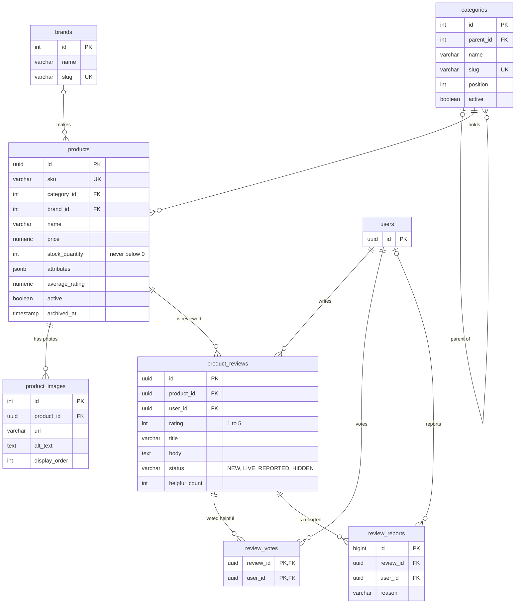
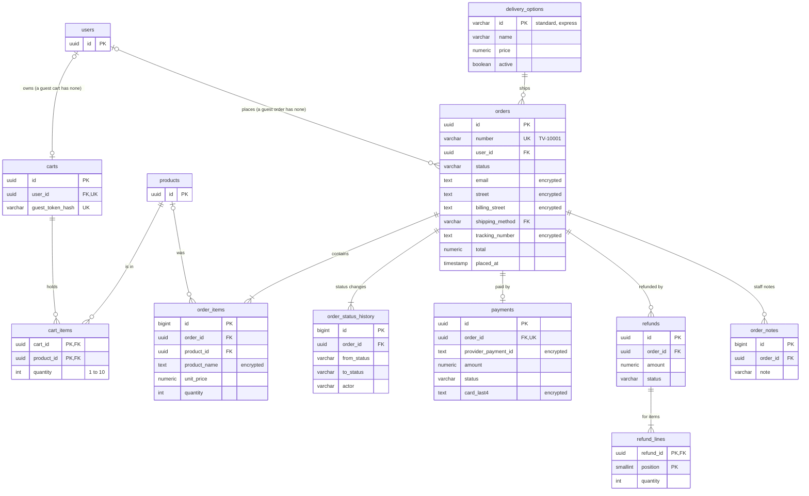
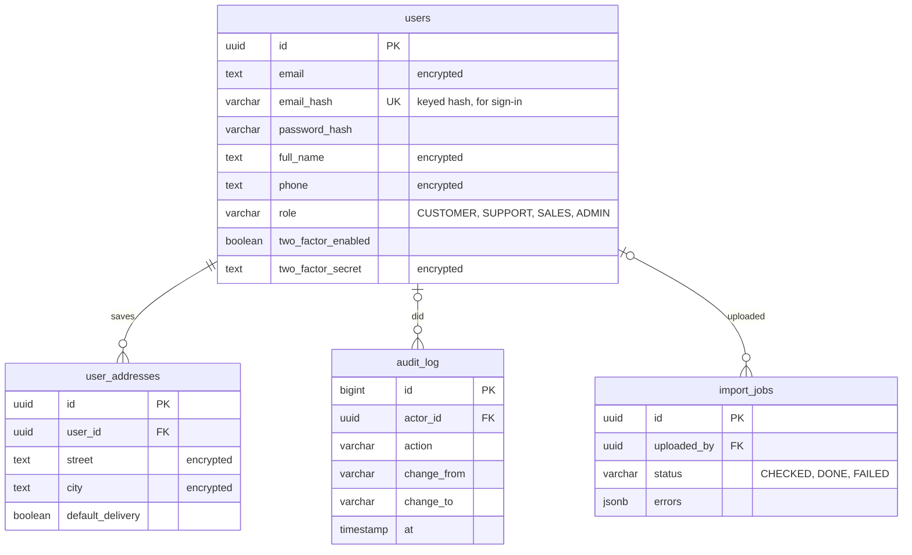

# i-love-shopping

An online shop (B2C e-commerce) for chess, Go and backgammon products: the storefront, the shopper's account,
and an **admin area** where staff run the products, orders, delivery, reviews and users. This is **Project 3
of 3**. It builds on Project 2 (cart, checkout, Stripe payments, orders) and Project 1 (accounts, login,
catalog), both folded away at the [end of this page](#project-2-cart-checkout-payments-and-orders).

The shop starts with about 1,770 real products (with photos and reviews), so there is something to put in the
cart right away. The assignment brief is in [docs/ASSIGNMENT3.md](docs/ASSIGNMENT3.md).

> **Reviewers:** every checklist item is answered in **[REVIEW_ANSWERS.md](REVIEW_ANSWERS.md)**, with where
> to find it in the code and which tests prove it. To get into the admin area, see [The admin area](#the-admin-area).

## Contents

1. [What you need](#what-you-need)
2. [Setup](#setup)
3. [What works](#what-works)
4. [The admin area](#the-admin-area)
5. [Usage guide](#usage-guide)
6. [Database](#database)
7. [How it works](#how-it-works)
8. [Tests](#tests)
9. [Performance analysis report](#performance-analysis-report)
10. [Troubleshooting](#troubleshooting)
11. [Where things are](#where-things-are)
12. [Project 2: cart, checkout, payments and orders](#project-2-cart-checkout-payments-and-orders)
13. [Project 1: accounts, login and the catalog](#project-1-accounts-login-and-the-catalog)

---

## What you need

| To... | You need |
|---|---|
| Run the shop | **Docker** with Docker Compose (Docker Desktop on Windows and Mac; Docker Engine and the Compose plugin on Linux). Nothing else: Java, Node, the database, RabbitMQ and the Stripe CLI all run inside containers |
| Pay with a card | A free **Stripe account**, for two test keys. An email address is enough: no business details, no real card, and test mode moves no money. Without the keys the shop still runs, but placing an order says payments are unavailable |
| Use the admin area | An **authenticator app** on your phone (Google Authenticator, Authy, or the iPhone's Passwords app): every staff account must use two-factor sign-in |
| Run the automated tests | Docker running (the tests start their own database, Redis and RabbitMQ), plus **Java 21** and **Maven 3.9+** for the server tests and **[Bun](https://bun.sh)** for the website tests |
| Read the emails the shop sends | Nothing: they all land in MailHog, a test inbox at <http://localhost:8025> |

The brief allows "Docker and the payment simulation CLI". The Stripe CLI runs in its own container
here, so you don't install it.

---

## Setup

### 1. Get your Stripe test keys

1. Sign up at <https://dashboard.stripe.com/register>. Skip the "activate payments" business
   questions: test mode doesn't need them.
2. Make sure the dashboard is in **test mode** (the switch or "Sandbox" label at the top).
3. Open **Developers → API keys** (<https://dashboard.stripe.com/test/apikeys>). Under
   **Standard keys**, copy the **Publishable key** (`pk_test_...`), then click **Reveal test key** and
   copy the **Secret key** (`sk_test_...`).

Use the standard secret key, the one starting with `sk_test_`. A *restricted* key (`rk_test_...`)
doesn't work: Stripe refuses the CLI with a 403, so no payment is ever confirmed.

### 2. Put them in `.env`

```sh
cp .env.example .env
```

Open `.env` and fill in:

```sh
STRIPE_PUBLISHABLE_KEY=pk_test_...
STRIPE_SECRET_KEY=sk_test_...
```

Leave `STRIPE_WEBHOOK_SECRET` and `APP_ENCRYPTION_KEY` empty: the start script fills them in. Every
other setting works as it is.

### 3. Start

```sh
./start.sh
```

The first start takes a few minutes while everything is built. The script:
- writes a random **encryption key** into `.env` (`APP_ENCRYPTION_KEY`). Keep that file: data saved
  with the key can't be read without it
- asks the Stripe CLI for its signing secret and saves it as `STRIPE_WEBHOOK_SECRET`, so the server
  trusts the payment results the CLI forwards
- builds and starts 7 containers

Then open:

| What | Where |
|---|---|
| The shop | <https://localhost:5443> (<http://localhost:5173> sends you there) |
| The admin area | <https://localhost:5443/admin> (needs a staff account: [The admin area](#the-admin-area)) |
| MailHog (every email the shop sends) | <http://localhost:8025> |
| RabbitMQ (the message queues) | <http://localhost:15672>, user `app`, password `changeme` |
| The API | <http://localhost:8080> |
| Database (PostgreSQL) | `localhost:5432`, database `iloveshopping`, user `app`, password `changeme` |

The shop uses a certificate made on your machine, not one from a certificate authority, so the
browser warns the first time. Choose **Advanced → Continue to localhost** (or **Accept the risk**)
once; the connection is still encrypted.

To check payments are wired up, run `docker compose ps stripe-cli`: it should say **Up**. If it says
*Exited*, see [Troubleshooting](#troubleshooting).

```sh
./start.sh down     # stop
./start.sh reset    # stop and wipe the database
```

Changed the Stripe keys later? Run `./start.sh` again: the website has to be rebuilt to pick up the
new publishable key.

---

## What works

**The admin area** (details and how to try it: [The admin area](#the-admin-area))
- Three staff roles, each with only what it needs: **Support** (orders, refunds, reviews), **Sales** (products,
  categories, bulk upload, delivery), **Admin** (everything, plus users and the audit log). The server checks
  the role on every request, not just the menu
- **Every staff member must use two-factor sign-in**, and can't turn it off
- Products, categories, orders, refunds, delivery options, review moderation, bulk upload (CSV or JSON),
  users and roles, and an **audit log** of every staff change that nobody can edit

**Reviews**
- Star ratings and text reviews, only from shoppers whose order with the product was delivered
- "Helpful" votes (one per shopper), sorting by most helpful, and reporting a review
- A hidden review leaves the shop and the average; its author still sees it, with the reason

**The shop and your account**
- Home, catalog and search (filters, sorting, grid or list, result count), product pages, cart, one-page
  checkout (guest or signed in), order confirmation, About, Contact, FAQ, Terms, and a friendly 404
- A cart preview and search suggestions in every page's header
- Your account: profile, order history, up to 10 saved addresses, two-factor sign-in, a download of
  everything the shop keeps about you, and deleting the account
- Card payments through Stripe's test mode, with emails for each step (all of it from Project 2)

**Security**
- Personal data is **encrypted in the database** (AES-256-GCM): accounts' email, name and phone, addresses,
  and on orders the contact details, what was bought and the payment records. The key is outside the
  database, in `.env`. Passwords and login tokens are stored only as one-way hashes
- The site runs on **HTTPS** with a self-signed certificate; plain http only redirects there
- **Rate limiting with token buckets**: short bursts are fine, a script hammering the shop gets
  "429, try again in N seconds"
- Every form is checked in the browser and again on the server

**Images, search engines and accessibility**
- Uploaded photos are saved in **three extra sizes** (160, 600 and 1200 px wide); a phone loads the small ones
- Every page has its **own title** and **description**, one main heading, headings in order, and readable
  addresses (`/catalog/{id}/walnut-chessboard-45-cm`)
- An automated **WCAG 2.1 A** check (axe-core, plus colour contrast and 200% zoom) finds nothing on any shop
  or account page. Photos have alt text and everything works with the keyboard

**Load test**
- Four shopper journeys (browse, search, buy, sign in) with k6, from 10 to 1,600 users at once:
  [Performance analysis report](#performance-analysis-report)

**Not built yet**
- Parcel tracking with a real courier: the parcel number is shown, but nothing asks the courier where it is
- Contact messages are only emailed; there is no inbox for them in the admin area
- The demo catalog's photos are linked from the suppliers' sites, so only uploaded photos get our three sizes
- Staff find a user by the **whole** email address, not the start of one: the email is encrypted

---

## The admin area

### Becoming an admin

Admin can't be given from the website, only from the server, so a stolen admin session can never make more
admins.

1. In the shop, **create an account** at `/register` (with a password, not Google).
2. Straight after, make the newest account an admin:
   ```sh
   docker compose exec postgres psql -U app -d iloveshopping \
     -c "UPDATE users SET role = 'ADMIN' WHERE id = (SELECT id FROM users ORDER BY created_at DESC LIMIT 1) RETURNING role"
   ```
   It prints `ADMIN`. (The email column is encrypted, so the command picks the newest account instead of
   searching by email.)
3. **Sign out and sign in again**, then open `/admin`. It asks you to **turn on two-factor sign-in** first:
   scan the QR code with your authenticator app and type the 6-digit code
   ([step by step](#setting-up-two-factor-login)). Then the admin area opens.

### Giving someone the Support or Sales role

1. Create a second account in another browser (or a private window).
2. As the admin: **Users and roles** → search for that account's **whole email** → choose the role → type
   your current 2FA code. The person's open sessions get the new role at once.
3. Signed in as that account, `/admin` asks it to turn on two-factor too, then shows only that role's pages.

### What each page does

| Page | Who sees it | What to try |
|---|---|---|
| **Overview** | Everyone on staff | What's waiting (orders to pack, reviews to check), today's sales, recent changes |
| **Orders** | Support, Admin | Pay for an order in the shop first ([test cards](#test-cards)). Then open it: **Start packing** → **Shipped** (courier and parcel number) → **Delivered**. The shopper gets an email at each step ([MailHog](http://localhost:8025)). Also: cancel while packing, a refund for one item, a team note, printable packing slips |
| **Delivery options** | Sales, Admin | Change a price or the free-shipping limit, then open the checkout: it shows the new price at once |
| **Products** | Sales, Admin | Add a product (every field, photos), edit one, hide or delete it. Tick several rows to show, hide, move or reprice them together. Export to CSV |
| **Categories** | Sales, Admin | Add, rename, hide, drag to reorder, move under another. Only an empty one can be deleted |
| **Bulk upload** | Sales, Admin | Upload a file from [docs/examples/](docs/examples/): `products-good.csv` and `products.json` pass the check; `products-bad.csv` has one mistake per line and the page names each one. Nothing changes until you confirm, and then all rows go in or none |
| **Reviews** | Support, Admin | New and reported reviews wait here: **Keep**, or **Hide** with a reason. A hidden review leaves the product page and its average |
| **Users and roles** | Admin | Find an account, change its role (needs your 2FA code) |
| **Audit log** | Admin | Every staff change and sign-in: who, what, before and after. Nobody can edit or delete it |

**Try the role limits:** as Sales, change a price by more than half: refused. As Support, refund more than
€100 on one order: refused. As Support, open `/admin/products`: not in the menu, and the server refuses it
too. Without two-factor, every admin page says to turn it on first.

**To write a review to moderate:** a review needs a delivered order. Buy a product as a shopper, mark the
order **Delivered** as staff, then write a review on that product's page. It shows up under **Reviews**.

---

## Usage guide

What each checklist item should show is in [REVIEW_ANSWERS.md](REVIEW_ANSWERS.md).

### In the shop

| Try this | Where |
|---|---|
| Featured products and categories | `/` |
| Filters, sorting, grid or list, paging | `/catalog`, or search from the header |
| Search suggestions while you type | The header's search box: type `wal` |
| Cart preview | Add something, then click the bag in the header |
| Reviews: sort by most helpful, vote, report | Any product page with reviews, signed in |
| Check out as a guest or signed in | The cart → **Checkout**, then a [test card](#test-cards) |
| Your profile, orders, addresses, data download | `/account` while signed in |
| Contact form | `/contact`: the message arrives in [MailHog](http://localhost:8025) |
| About, FAQ, Terms, 404 | `/about`, `/faq`, `/legal/terms`, any made-up address |

### Test cards

Any future expiry date, any CVC, any postcode:

| Card number | What happens |
|---|---|
| `4242 4242 4242 4242` | Paid |
| `4000 0025 0000 3155` | The bank asks for a security check (3-D Secure) first, then paid |
| `4000 0000 0000 9995` | Declined: not enough money |
| `4000 0000 0000 0069` | Declined: expired card |
| `4000 0000 0000 0127` | Declined: wrong CVC |
| `4242 4242 4242 4241` | Stripe's form says the number is wrong, before anything is sent |

### Checking security, SEO, accessibility and load

| Check | How |
|---|---|
| Data is encrypted in the database | `docker compose exec postgres psql -U app -d iloveshopping -c "SELECT email, full_name FROM users LIMIT 3"`: scrambled `v1:` text, while signing in works. Same for orders: `... -c "SELECT number, first_name, street, total FROM orders LIMIT 3"` |
| HTTPS | Click the padlock at <https://localhost:5443>, or `curl -I http://localhost:5173` to see the redirect |
| Rate limiting | `for i in $(seq 12); do curl -ks -o /dev/null -w "%{http_code} " -X POST https://localhost:5443/auth/login -H "Content-Type: application/json" -d "{\"email\":\"try$i@example.com\",\"password\":\"wrong-password\"}"; done`: `401` ten times, then `429` |
| Photo sizes | Upload a photo to a product in the admin area, then open its page with the browser's network tab: a phone-sized window loads the 160 or 600 px file |
| Titles, headings, contrast, alt text, 200% zoom | `cd frontend && bun run a11y-check / /catalog /bag /contact` while the shop runs |
| 320, 768, 1024 and 1440 px screens | `cd frontend && bun run layout-check --widths=320,768,1024,1440 / /catalog /bag`, or resize the browser |
| The load test | `loadtest/run.sh 50 400` (about 4 minutes), then `loadtest/run.sh down` |

Any database tool works too (DBeaver, pgAdmin, VS Code's SQLTools): host `localhost`, port `5432`,
database `iloveshopping`, user `app`, password `changeme`.

---

## Database

PostgreSQL. The tables are created on startup by numbered migration files in
`backend/src/main/resources/db/migration` (`V1` to `V16`). The diagram is split in three so it stays
readable; `users`, `products` and `orders` appear in more than one, with only their key. *Encrypted* marks
columns stored scrambled.

**Catalog and reviews**



**Cart, orders and payments**



**Accounts and staff**



| Table | Holds |
|---|---|
| `categories`, `brands` | The category tree (each can have a parent) and the brands |
| `products`, `product_images` | Products with price, stock, weight and size in both unit systems, and their photos |
| `product_reviews`, `review_votes`, `review_reports` | Reviews (1–5 stars and text), one "helpful" vote per shopper, and reports waiting for staff |
| `users`, `user_addresses` | Accounts (personal columns encrypted) and up to 10 saved addresses each |
| `carts`, `cart_items` | One cart per account or per guest. No prices: they're read fresh from `products` |
| `orders`, `order_items`, `order_status_history` | An order, a copy of what was bought, and every status change |
| `payments`, `refunds`, `refund_lines` | The Stripe payment behind an order, and whole or part refunds |
| `delivery_options`, `shop_settings` | Delivery options staff can edit, and the free-shipping limit |
| `order_notes`, `audit_log`, `import_jobs` | Staff notes on orders, the uneditable log of staff actions, and bulk uploads |
| `processed_payment_events` | Stripe messages already handled, so one sent twice is applied once |

Order statuses and who may move them: [claude-docs/ORDER_STATES.md](claude-docs/ORDER_STATES.md). Ids,
statuses, dates and money stay readable, because the database filters and sorts on them.

---

## How it works

| Part | Technology |
|---|---|
| Website | React 18, TypeScript, Vite. Redux Toolkit and React Query for state, Axios for requests, Stripe.js for the card form |
| Server | Java 21, Spring Boot 4, Spring Security, stripe-java |
| Database | PostgreSQL 16, with the schema managed by Flyway |
| Sessions and rate limits | Redis 7 |
| Message queue | RabbitMQ 4 |
| Email (development) | MailHog |
| Payments | Stripe (test mode), with the Stripe CLI forwarding its webhooks |
| Everything runs in | Docker Compose: 7 containers (website, server, database, Redis, RabbitMQ, MailHog, Stripe CLI) |

The server is one application split into areas: users, login, catalog, cart, orders, payments, delivery,
audit, overview and support. Each area talks to the others only through a small interface.

**Staff roles and two-factor.** One table in the server (`auth/StaffArea.java`) says which role may use which
area. Every admin request is checked against it, and also needs a session that gave a 2FA code. Changing
someone's role ends their open sessions, so the new role applies at once.

**Audit log.** Every staff change and sign-in writes a row: who, what, before and after. A database trigger
refuses any edit or delete for 12 months, so not even the server can rewrite history.

**Bulk upload.** The file is checked row by row against the same rules as the product form, without changing
anything. Confirming imports every row in one database transaction: all or nothing.

**Encryption.** Personal and payment details are encrypted with AES-256-GCM before they're saved; a changed
byte is detected instead of decrypted to nonsense. An encrypted email can't be searched, so the database
also keeps a keyed hash of it, which is what sign-in looks up. The key comes from `.env`.

**Rate limits (token buckets).** Each address gets a bucket of tokens per action in Redis (sign-in: 10,
refilled one every 6 seconds). A request takes a token; an empty bucket answers 429 with how long to wait.

**Images.** An uploaded photo is saved at its own size plus 160, 600 and 1200 px wide, and the browser picks
the smallest that is sharp enough. nginx serves them with a year-long cache. In production a CDN would sit in
front; a photo's name changes whenever it does, so nothing cached is ever stale.

**Search engines.** Each page sets its own title and description, products have readable addresses, and
pages use real headings, lists, navigation and buttons, which also helps screen readers.

---

## Tests

Needs Docker running, Java 21 and Maven for the server, Bun for the website (see
[What you need](#what-you-need)). The shop doesn't have to be running.

```sh
cd backend && mvn verify       # server: 444 tests, a few minutes
cd frontend && bunx vitest run # website: 132 tests, seconds
```

**Latest run (2026-10-12): 576 tests, all passing.** Server tests run against a real PostgreSQL, Redis and
RabbitMQ that the tests start themselves; Stripe and the mail server are replaced by stand-ins, so no keys
or internet are needed.

| The brief asks for | Tests |
|---|---|
| Unit: product data model | `ProductRequestValidationTest`, `PriceGuardTest`, `CsvReaderTest` |
| Unit: cart | `CartServiceTest`, `CartPanel.test.tsx` |
| Unit: order summary | `OrderTotalsTest`, `shipping.test.ts` |
| Unit: JWT | `JwtServiceTest` |
| Unit: input validation | `authRules.test.ts`, `checkoutRules.test.ts`, `addressRules.test.ts`, `InputValidationIT` |
| API endpoints and the database | Every `*IT`, e.g. `StaffCatalogIT`, `StaffOrderIT`, `ImportIT`, `AccountIT`, `ReviewModerationIT` |
| Flow: product search | `SearchIT` |
| Security: rate limiting | `TokenBucketIT`, `RateLimitIT` |
| Security: admin roles and 2FA | `StaffAccessIT`, `StaffUserIT`, `AuditLogIT` |

How the tests are organised: [backend/README.md](backend/README.md#tests) and
[frontend/README.md](frontend/README.md#tests).

---

## Performance analysis report

**How it was tested.** [k6](https://k6.io) runs in Docker against a separate copy of the whole shop (nginx,
server, PostgreSQL, Redis, RabbitMQ), started by `loadtest/run.sh` with its own data, so the numbers include
TLS, the proxy and the real database. Each virtual user is one shopper who pauses 1 to 8 seconds between
pages, like someone reading, and repeats one of four journeys ([loadtest/shop.js](loadtest/shop.js)):

| Journey | Share | Steps |
|---|---:|---|
| Browse | 45% | Categories, a shelf's listing, a product and its reviews |
| Search | 30% | Suggestions while typing, the results, a product |
| Buy (as a guest) | 15% | A product, add to cart, the cart, delivery options, place the order |
| Sign in | 10% | Sign in, the profile, my orders |

Each step count runs for a minute, and all its users start in the same second (the worst case: a sale
email sent to everyone at once). A *transaction* is one finished journey; requests are counted too.
Photos aren't requested: nginx serves them from disk without touching the server.

**Machine.** One laptop: AMD Ryzen 7 4800H (8 cores, 16 threads), Docker with 3.7 GB of memory. The server
container is limited to **2 CPU cores and 1 GB**, like a small cloud machine; the database and k6 itself
are not limited, and k6 shares the laptop's CPU with the shop. Payments go to a stand-in for Stripe (Stripe's
test mode allows 25 requests a second), and an unpaid order releases its stock after 2 minutes instead of 30.

**Results** (after the fix below; [loadtest/results/2026-10-12-2228](loadtest/results/2026-10-12-2228/summary.md)
and [2026-10-12-2244](loadtest/results/2026-10-12-2244/summary.md)). Server CPU is the average once every
user has arrived:

| Users | Requests/s | Journeys/s | Median | 90% within | 95% within | Failed requests | Journeys OK | Server CPU | Server memory | Database CPU |
|---:|---:|---:|---:|---:|---:|---:|---:|---:|---:|---:|
| 10 | 4.1 | 0.7 | 26 ms | 100 ms | 108 ms | 0% | 100% | 12% | 41% | 0.0 cores |
| 25 | 9.4 | 1.8 | 13 ms | 47 ms | 77 ms | 0% | 100% | 12% | 42% | 0.1 |
| 50 | 18.0 | 3.7 | 9 ms | 39 ms | 68 ms | 0% | 100% | 15% | 43% | 0.1 |
| 100 | 34.9 | 7.3 | 8 ms | 37 ms | 82 ms | 0% | 100% | 19% | 45% | 0.2 |
| 200 | 69.6 | 14.5 | 7 ms | 38 ms | 99 ms | 0% | 100% | 29% | 47% | 0.3 |
| 300 | 102.3 | 21.4 | 7 ms | 91 ms | 360 ms | 0.19% | 99.6% | 37% | 48% | 0.5 |
| 400 | 135.7 | 28.5 | 6 ms | 96 ms | 425 ms | 0.07% | 99.8% | 38% | 49% | 0.6 |
| 600 | 197.6 | 41.9 | 6 ms | 98 ms | 1.2 s | 0.10% | 99.7% | 55% | 52% | 0.8 |
| 800 | 234.3 | 49.6 | 28 ms | 1.6 s | 2.6 s | 0.78% | 98.0% | 74% | 56% | 0.9 |
| 1200 | 289.2 | 58.3 | 691 ms | 2.9 s | 4.6 s | 1.69% | 95.6% | 86% | 62% | 1.1 |
| 1600 | 303.2 | 58.1 | 1.5 s | 5.4 s | 8.9 s | 2.18% | 94.5% | 88% | 63% | 1.3 |

Every failed request was a **409**: the shop refusing to put in a cart, or sell, stock that other test buyers'
unpaid orders were holding. There was no server error and no timeout at any step. The buy journeys pick from
under 200 products and every unpaid test order holds its items for 2 minutes, so the more buyers, the more of
those products are held: a limit of the test data, not of the server.

**Against the brief's targets:**

| Target | Result |
|---|---|
| 90% of requests within 2 seconds | Met up to 800 users (1.6 s); 2.9 s at 1,200 |
| At least 50 users without slowing down | 50 users: 95% within 68 ms, the same as at 10 |
| At least 10 transactions a second at peak | 14.5 journeys (70 requests) a second at 200 users; at most 58 journeys (300 requests) |
| 98% of transactions succeed | Met up to 800 users (98.0%) |
| Error rate under 5% | Under 2.2% at every step |

**What the brief asks to identify:**
- **Most users before responses take over 5 seconds:** about **1,200**. There, 95% of requests finish within
  4.6 s; at 1,600 it is 8.9 s. Throughput also stops growing there (289 → 303 requests a second): the server is
  full.
- **Throughput:** about **50 journeys (230 requests) a second** with good response times (800 users), at most
  58 journeys (300 requests) a second.
- **Normal and peak load:** a specialist shop like this one expects tens of shoppers at once on a normal day;
  we take **25 to 50** as normal and **200** as a sale peak. Both are far inside the limits: at 200 users 95% of
  requests take under 0.1 s and the server uses under a third of its CPU.
- **CPU or memory over 90%:** the server's 2 cores reach **100% for the first seconds of every step from 300
  users** (everyone arriving at once), and average **86 to 88% from 1,200 users** on. Memory never passes 63% of
  its 1 GB: memory is not the limit.

**Bottlenecks, with the evidence:**
1. **Two-letter search suggestions (fixed).** Sampling the database's running queries at 400 users showed the
   suggestion query in 17 of 23 samples. Two letters are too short for the trigram index (a trigram is three
   letters), so each one read all 1,772 products: about 10 ms of database CPU, against 0.6 ms from three letters
   (`EXPLAIN ANALYZE`). The search box asks at two letters, so every search did this. **Fix:** two-letter answers
   are kept in memory for 30 seconds (`PostgresSearchService.suggest`, tested in `SearchIT`). After it the query
   was in 5 of 27 samples, suggestions' 95th percentile at 600 users fell from 1.6 s to 0.5 s, and the database's
   CPU at 600 users fell from 1.0 to 0.8 cores ([before](loadtest/results/2026-10-12-1830/summary.md)).
2. **Everyone arriving at once.** At 600 users, nearly all slow requests fall in the first 10 seconds; after the
   first 15 seconds 95% of requests finish within 85 ms. The burst queues work on the server's 2 cores and its
   10 database connections. **Proposed:** run two or more server containers behind nginx (they keep no state of
   their own, so any of them can answer any request), and cache what every first page asks for, the category
   tree, for a few seconds.
3. **Sign-in.** The slowest request once the burst is over (95% within 1.1 s at 600 users, against 19 ms for
   suggestions): checking a password with bcrypt is slow on purpose, and costs CPU on the 2 cores. Making it
   cheaper would make stolen hashes easier to crack, so the fix is **more CPU for the server**, not a weaker hash.
4. **Listing counts.** The next most frequent database work: each listing counts brands, prices and ratings for
   its filters, four queries per page. **Proposed:** keep the counts of an unfiltered shelf for a minute, since
   they change only when products do.

**Images and static files (CDN).** Not part of the run: nginx serves them from disk, cached for a year. In
production a CDN in front of nginx would serve them from near the shopper; see
[How it works](#how-it-works) → Images.

To run it yourself: `loadtest/run.sh` (the steps 10 to 400), or `loadtest/run.sh 50 800` for chosen steps; then
`loadtest/run.sh down`. Each run writes its own folder in `loadtest/results/`.

---

## Troubleshooting

- **Pay says payments are unavailable, or the card form says it isn't set up:** the Stripe keys are
  missing from `.env`. Add them and run `./start.sh` again (the website has to be rebuilt).
- **`stripe-cli` says *Exited*, or the order page keeps saying "Confirming your payment":** the
  Stripe CLI isn't forwarding. Run `docker compose logs stripe-cli`. A `403` with
  `more_permissions_required` means `STRIPE_SECRET_KEY` is a restricted key (`rk_test_...`): put the
  standard secret key (`sk_test_...`) in its place and run `./start.sh` again.
- **A database tool says `password authentication failed for user "app"`:** the password is
  `changeme`. The database keeps the password it was created with, so if you changed
  `POSTGRES_PASSWORD` after the first start, either use the old one or run `./start.sh reset`.
- **The browser warns the site isn't secure:** expected once, see [Setup](#3-start). The certificate is
  made on your machine rather than by a certificate authority; the connection is still encrypted.
- **`docker compose` says `APP_ENCRYPTION_KEY` is missing:** run `./start.sh` once. It makes the key.
- **Orders fail to open after changing `.env`:** the encryption key changed. Put the old one back, or
  run `./start.sh reset` to start over with an empty database.
- **Port already in use:** change `FRONTEND_PORT`, `FRONTEND_HTTPS_PORT` or `BACKEND_PORT` in `.env`
  and start again.
- **Server won't start after an update:** run `./start.sh reset` to start with a fresh database.
- **The admin pages only say "turn on two-factor sign-in":** expected for every staff account until it has
  2FA. Turn it on there, and the pages open.
- **`/admin` sends you back to the shop after making yourself admin:** sign out and in again. The role is read
  at sign-in.
  This includes a database made while Project 3 was being built, before its migrations were final.
- **`bun run a11y-check` can't find a browser:** it uses Playwright's Chromium. Run
  `bunx playwright-core install chromium-headless-shell` in `frontend/`, or point `CHROME_PATH` at a Chrome or Chromium.
- **The load test's copy of the shop is still running:** `loadtest/run.sh down` stops it and deletes its data.
- **No email arrives:** emails never leave your machine; they all appear in MailHog. If MailHog was
  down, the email waits in the `orders.emails.dlq` queue in RabbitMQ (see
  [Seeing the queues](#seeing-the-queues)).
- **Can't stay logged in:** open the site at `localhost`, not your computer's network IP.

---

## Where things are

| Folder or file | What it is |
|---|---|
| [backend/](backend/README.md) | The server. Its README maps every feature to the file that handles it, and explains the tests |
| [frontend/](frontend/README.md) | The website. Its README lists the pages, folders and tests; the admin area is in `frontend/src/admin/` |
| [tools/catalog-import/](tools/catalog-import/README.md) | The Python scripts that build the demo catalog |
| [REVIEW_ANSWERS.md](REVIEW_ANSWERS.md) | Answers to the review checklist, with code and test references |
| [docs/](docs/) | The assignment briefs and example bulk upload files in `docs/examples/` |
| [loadtest/](loadtest/) | The load test: k6 script, the separate stack it runs against, and each run's results |
| `rabbitmq/` | Which RabbitMQ plugins are on (the management page and Move messages) |
| `CLAUDE.md`, `claude-docs/`, `.claude/` | Instructions and notes for Claude Code, the AI assistant used while building this |
| `homework/` | The author's study notes for the topics in this project |
| `start.sh`, `docker-compose.yml`, `.env.example` | Startup script, container setup, and the list of settings |

---

## Project 2: cart, checkout, payments and orders

Project 2 is finished and everything in it still works. Its brief is in
[docs/ASSIGNMENT2.md](docs/ASSIGNMENT2.md) and its review answers are in
[REVIEW_ANSWERS.md](REVIEW_ANSWERS.md#project-2).

<details>
<summary><b>Show Project 2</b>: what works, how the cart, payments, queues and refunds work, and its API</summary>

### What works in Project 2

**Cart**
- Each line shows the product's photo, name, options, price and quantity. The totals update as you
  add, remove or change quantities
- The cart is saved on the server. A guest's cart is kept for 30 days; a logged-in shopper's cart
  follows their account to any browser
- Logging in moves the guest cart into the account's cart. If both have the same item, the bigger
  quantity is kept (not the two added together)
- The server sets every price and checks the stock. Adding more than is in stock says how many are
  left; an item that sells out while in the cart is marked and left out of the total
- "Goes with your order": suggestions in the cart from the same game, sensibly priced

**Checkout**
- One page with contact, address, shipping options, the card and an order summary where quantities
  can still change or items be removed
- Every field is checked, in the browser and again on the server, with a message that says how to
  fix it
- Logged-in shoppers get their name and email from the account, and their phone and address from
  their last order
- The address is checked: the postcode must have the right format for the country, and for the
  biggest cities (Tallinn, Tartu, Riga, Vilnius, Helsinki and others) it must belong to the city
- After paying, an order confirmation page and a confirmation email

**Payments**
- Card payments through Stripe's test mode. The card is typed into Stripe's own form, so card
  details never reach this server. Stripe checks the card number, expiry date and CVC before paying
- The order becomes *Payment successful* or *Payment failed* only when Stripe's server tells ours
  (a signed webhook), never because the browser says so
- A declined card (not enough money, wrong number, expired) says why, and the shopper can try
  another card on the same order. If Stripe can't be reached, nothing is charged and the cart is kept
- Stripe's messages go through a **message queue** (RabbitMQ) to the part of the server that updates
  the order. A message that keeps failing is set aside in a *dead letter queue* instead of being lost
- Emails for a paid order, a declined payment, a cancellation and a refund. They go through a queue of
  their own, so a broken mail server never holds up a payment

**Orders**
- Placing an order reserves the stock straight away, so two people can never buy the last item
  twice. An unpaid order holds its items for 30 minutes, then they go back on sale
- The order keeps a copy of each item's name and price, so later price changes don't alter it
- *Your orders* on the account page: filter by status and date, sort, and open any order for its
  full details and status history
- Cancelling an order before it is packed: the items go back on sale at once and Stripe refunds the
  card. Once packing has started the server refuses (guests can cancel from their order page too)

**Extras beyond the brief**
- Refunds go all the way through Stripe, and are retried every minute if Stripe is down
- An unpaid order releases its items by itself after 30 minutes, and cancels the payment at Stripe
- If Stripe's message about a payment is lost, a job asks Stripe directly before releasing anything
- Cards that need a bank security check (3-D Secure) work
- The postcode is checked against the city, not just its format

### How Project 2 works

**The cart.** A guest's cart is found by a random token in a cookie JavaScript can't read; the
database keeps only a hash of it. A logged-in shopper's cart belongs to their account. Prices are
never stored in the cart: they are read from the products every time, so the cart can't show an old
price.

**Placing an order.** In one database transaction the server takes the stock for every item, copies
the cart into the order, and empties those lines from the cart. Stock is taken with a single
"take it only if there's enough" update, so when two people buy the last item at the same moment,
exactly one succeeds and the other is told it sold out. If any item is short, the whole order is
undone.

**Paying (Stripe).** The server asks Stripe for a payment for the order's total. The browser shows
Stripe's card form, which sends the card straight to Stripe, and Stripe tells our server the result
by calling its webhook. The server checks that call's signature, so a fake "paid" message is
rejected. If the webhook is lost, a job that runs every minute asks Stripe directly before releasing
an unpaid order's items.

**The message queue.** The webhook only checks the signature, puts the payment's result on a RabbitMQ
queue and answers Stripe at once. A separate listener takes it off the queue and, in one database
transaction, updates the order, its stock and its history. Each Stripe message is applied once, even
if it arrives twice. If applying it fails, it is retried twice more; after that it is moved to a
*dead letter queue*, where it waits to be looked at and moved back, instead of being lost or retried
forever.

**Emails.** Only after that transaction has saved does the server put "this order needs an email" on a
second queue, so nobody gets an email about a change that didn't happen. A second listener writes the
email from the order and sends it. If the mail server is down, the email is retried and then waits in
its own dead letter queue, while payments carry on.

**Cancelling and refunds.** A paid order can be cancelled until packing starts. In one transaction the
order becomes *Cancelled* and its stock goes back on sale; then the server asks Stripe for the refund.
When Stripe confirms it, the order becomes *Refunded*. If Stripe can't be reached, the order stays
cancelled and a job asks Stripe again every minute. Each refund is sent with the order's own id as a
key, so asking twice never refunds twice.

### Trying Project 2 in the website

| Try this | Where |
|---|---|
| Add to cart, change quantities, see suggestions | Any product page, then the cart in the header |
| Ask for more than is in stock | A product page that says *Only N left*: raise its quantity in the cart past N, and the cart says how many are left |
| Keep a cart as a guest, then log in | Add items logged out, then log in: they move into the account's cart |
| Check out | The cart → **Checkout** (as a guest or logged in) |
| See prefilled details | Log in, place one order, then start another: phone and address are filled in |
| See the address check | Checkout with city `Tallinn` and postcode `50090` (a Tartu postcode) |
| Pay, and see a declined card | Checkout with a [test card](#test-cards) |
| The emails for paid, declined, cancelled, refunded | [MailHog](http://localhost:8025) |
| Your orders, filters, sorting, order details | `/account/orders`, while logged in |
| Cancel an order and get a refund | Open a paid order → **Cancel order**. Watch the product's stock go back up |

After a declined card the order page offers **Try another card** for the same order. Payments and
refunds show under **Payments** in the Stripe dashboard (test mode). Stripe's events as they arrive:
`docker compose logs -f stripe-cli`.

### Seeing the queues

Open RabbitMQ at <http://localhost:15672> → **Queues**. `orders.payment-events` takes Stripe's results,
`orders.emails` the emails, and each has a `.dlq` (dead letter queue) beside it.

- **A bad message set aside:** open `orders.payment-events` → **Publish message**, type `not json` as
  the payload, publish, and after a few seconds it appears in `orders.payment-events.dlq`.
- **An email waiting out a mail server failure:** run `docker compose stop mailhog`, pay an order, and
  the email lands in `orders.emails.dlq`. Run `docker compose start mailhog`, open that queue →
  **Move messages** to `orders.emails`, and it arrives.

### The API

The website covers everything; these are the Project 2 endpoints behind it.

| Endpoint | Does |
|---|---|
| `GET /cart`, `POST /cart/items`, `PUT/DELETE /cart/items/{productId}` | The cart (guests too, by cookie) |
| `POST /cart/merge` | Move the guest cart into the account's (logged in) |
| `POST /orders`, `GET /orders/{id}` | Place an order from the cart, read it (guests too) |
| `POST /orders/{id}/payment` | Pay a declined order again with another card |
| `POST /orders/{id}/cancel` | Cancel a paid order before packing, with a refund (guests too) |
| `GET /orders?status=&from=&to=&sort=&page=` | Your orders, filtered and sorted (logged in) |
| `GET /orders/last-delivery` | The phone and address of your last order, for the checkout (logged in) |
| `POST /payments/webhook` | Where Stripe reports payments (checked by signature) |

</details>

---

## Project 1: accounts, login and the catalog

Project 1 is finished and everything in it still works. Its brief is in
[docs/ASSIGNMENT.md](docs/ASSIGNMENT.md) and its review answers are at the end of
[REVIEW_ANSWERS.md](REVIEW_ANSWERS.md).

<details>
<summary><b>Show Project 1</b>: what works, how login and search work, two-factor setup, Google keys and API</summary>

### What works in Project 1

**Accounts and security**
- Sign up and log in with email and password, or with Google
- CAPTCHA on sign-up (off by default; turn on with `RECAPTCHA_ENABLED=true` and your keys in `.env`)
- Password reset by email
- Optional two-factor login (authenticator app, plus 8 one-time backup codes)
- Short-lived access tokens kept only in memory, refresh tokens in a cookie JavaScript cannot read
- Each refresh token works exactly once; reusing an old one is rejected
- Logout invalidates both tokens; a password reset logs out every device
- Rate limiting on login, sign-up and search

**Catalog**
- Categories you can browse level by level, starting from the four games
- Search with filters for category, brand, price and rating, and suggestions while you type
- Tolerates typos (`stanton` still finds Staunton sets)
- Sorting by relevance, price, rating and newest
- Product pages with photos, specs in metric and imperial, colour/size options and reviews
- Admins can add, edit and delete products and upload images

**Not built yet:** deleting your own review from the website (the API supports it).

### Where the product data comes from

The products are real listings from three chess, Go and
backgammon suppliers. A few **Python scripts** in [tools/catalog-import](tools/catalog-import/README.md)
download the suppliers' product pages and turn them into one SQL file, which the database loads on
startup. The scripts are a one-off tool the developer runs by hand, not part of the shop, and the
finished SQL file is committed, so **you don't need Python to run the project**.

### How login works

**Login tokens (JWT).** Logging in returns two tokens. The *access token* is a signed JWT (library:
jjwt) that lasts 15 minutes and holds only the user id and role, no personal data. The website keeps
it in memory only, never in browser storage. The *refresh token* lasts 7 days and sits in an
`httpOnly` cookie that JavaScript can't read. After a page reload, the website uses the refresh
token to get a new access token.

**Single-use refresh tokens.** Every refresh swaps the old refresh token for a new one in Redis in
one atomic step (a small Lua script), so the same token can never be used twice, even by two
requests at the same moment.

**Logout.** The access token's id goes on a blocklist in Redis until the token would have expired
anyway, and the refresh token is deleted.

**Two-factor login (TOTP).** The standard authenticator-app method (library: `dev.samstevens.totp`).
The server creates a secret, the website shows it as a QR code, and the app then shows a new 6-digit
code every 30 seconds. After 2FA is on, logging in takes the password *and* a current code.

**CAPTCHA.** Google reCAPTCHA on sign-up. The server checks the CAPTCHA token with Google before
creating the account.

**Google login.** The website gets an ID token from Google, and the server checks that token's
signature against Google's public keys before logging the user in.

**Password reset.** The server emails a one-time link that expires. Using it sets the new password
and logs the account out everywhere.

**Validation.** Forms are checked in the browser for quick feedback, and every request is checked
again on the server, because the browser checks can be bypassed.

**Image upload.** The server checks the file's actual contents, not its name, to confirm it's a
JPEG or PNG. It then re-saves the image, which strips anything hidden inside it, and stores it under
a random name.

### Search

Search uses PostgreSQL's built-in full-text search, so no separate search engine is needed.

- **Matching.** Every product has a pre-built search index made from its name, description and
  attributes (such as wood type). A match in the name ranks above a match in the description.
- **Typos.** If nothing matches exactly, the search falls back to "similar-looking" names
  (the `pg_trgm` extension), so `stanton` still finds Staunton sets. The page says when it did this.
- **Filters.** Results can be narrowed by category, brand, price range and rating. Each filter shows
  how many results it would leave.
- **Sorting.** By relevance, price, rating or newest.
- **Suggestions.** Product names appear while you type, from 2 characters on.
- **Speed.** Indexes keep searches fast. They were tested on 50,000 products.

Search is behind one interface in the code, so it can be swapped for a dedicated search engine
(such as Elasticsearch) later without changing anything else.

### Trying Project 1 in the website

| Try this | Where |
|---|---|
| Browse, filter and sort | `/catalog`: pick a category, brand, price or rating, change the sort |
| Search with suggestions | Search box in the header: type `wal` |
| Create an account | `/register` |
| Reset your password | `/login` → *Forgot your password?*, then open the email in [MailHog](http://localhost:8025) |
| Turn on two-factor login | `/account` (see below) |
| Write a review | Any product page, while logged in |

### Setting up two-factor login

First, on the website:
1. Log in and open `/account`.
2. Type your password and click **Set up two-factor**. A QR code and a long **setup key** appear.

Then add it to an app on your phone. Pick **one** of these:

*Option A: Google Authenticator or Authy (easiest)*
1. Install the app from the App Store or Google Play.
2. Open the app and tap **+** → **Scan a QR code**.
3. Scan the QR code on the screen. An entry called **i-love-shopping** appears with a 6-digit code.

*Option B: the Passwords app on an iPhone (no install)*

Scanning with the camera alone won't work: the Passwords app needs a saved entry for the site
first, and it has none for this one.
1. Open **Passwords** and tap **+** to add a new entry.
2. Set **Website** to `localhost`, **User name** to your email, and **Password** to your password.
   Save.
3. Open that entry, tap **Edit** → **Set Up Verification Code**.
4. Choose **Scan QR Code** and scan the screen, or choose **Enter Setup Key** and type the long key.
5. The entry now shows a 6-digit code.

Finish on the website:
1. Type the **6-digit code** from your phone into the box. Don't type the long setup key there.
   The code changes every 30 seconds, so use the current one.
2. Click **Turn on two-factor**.
3. Write down the 8 backup codes. They are shown only once. Each one works once if you lose your
   phone.

From then on, logging in asks for the current 6-digit code after your password.

### Needs your own Google keys

CAPTCHA and Google login are built, but they're switched off by default so the project runs without
any Google accounts or keys. Both need a (free) Google account. The keys go into `.env`.

**CAPTCHA on sign-up**
1. Go to <https://www.google.com/recaptcha/admin/create> and sign in with Google.
2. Fill in the form:
   - **Label:** anything, e.g. `i-love-shopping`
   - **reCAPTCHA type:** **Challenge (v2)** → **"I'm not a robot" Checkbox**
   - **Domains:** `localhost`
3. Click **Submit**. The next page shows a **Site key** and a **Secret key**.
4. Open `.env` and set:
   ```sh
   RECAPTCHA_ENABLED=true
   RECAPTCHA_SITE_KEY=<the site key>
   RECAPTCHA_SECRET_KEY=<the secret key>
   ```

**Sign in with Google**
1. Go to <https://console.cloud.google.com> and sign in. At the top, open the project picker →
   **New project**, name it anything, and create it.
2. In the search bar, open **Google Auth Platform** and click **Get started**. Enter an app name and
   your email, choose **External**, and finish the steps.
3. Under **Audience** → **Test users**, add the Google account you'll log in with. While the app is in
   testing, only these accounts can sign in.
4. Under **Clients** → **Create client**:
   - **Application type:** **Web application**
   - **Authorised JavaScript origins:** add `https://localhost:5443` (and `http://localhost:5173` if
     you also run the website with `bun run dev`)
   - Leave **Authorised redirect URIs** empty.
5. Click **Create** and copy the **Client ID** (it ends in `.apps.googleusercontent.com`). You don't
   need the client secret.
6. Open `.env` and set:
   ```sh
   GOOGLE_CLIENT_ID=<the client ID>
   ```
   A new client can take a few minutes to start working.

**Then restart the project**

Run `./start.sh`. It rebuilds the website with the new keys, and a restart without the rebuild isn't
enough. Open the site at `https://localhost:5443`, not `127.0.0.1`, because Google only accepts the
addresses you registered. The CAPTCHA box then appears on `/register`, and the **Sign in with
Google** button on `/login`.

If you'd rather skip this, the automated tests still cover both features (`CaptchaServiceTest`,
`GoogleTokenVerifierTest`).

### Project 1 API

Some things can only be done through the API, like admin actions and checking by hand that an old
refresh token is rejected.

```sh
# log in: the response body has the access token, the refresh token comes back as a cookie
curl -i -X POST http://localhost:8080/auth/login \
  -H 'Content-Type: application/json' \
  -d '{"email":"you@example.com","password":"your password"}'

# get a new access token; run it twice with the same cookie and the second call is rejected
curl -i -X POST http://localhost:8080/auth/refresh -b 'refresh_token=<cookie value>'

# search
curl 'http://localhost:8080/products?q=walnut&minPrice=25&maxPrice=100&sort=price_asc'
```

| Endpoint | Does |
|---|---|
| `POST /auth/register`, `/auth/login`, `/auth/logout`, `/auth/refresh` | Sign up, log in, log out, renew the session |
| `POST /auth/forgot-password`, `/auth/reset-password` | Password reset |
| `POST /auth/2fa/setup`, `/auth/2fa/enable`, `/auth/2fa/login` | Two-factor login |
| `POST /auth/oauth/google` | Log in with Google (needs `GOOGLE_CLIENT_ID` in `.env`) |
| `GET /products`, `/products/{id}`, `/categories`, `/brands` | Browse and search the catalog |
| `GET /search/suggestions?q=` | Suggestions while typing |
| `POST /products/{id}/reviews` | Write a review (logged in) |
| `POST/PUT/DELETE /products`, `POST /products/{id}/images` | Manage products and images (admin) |

</details>
