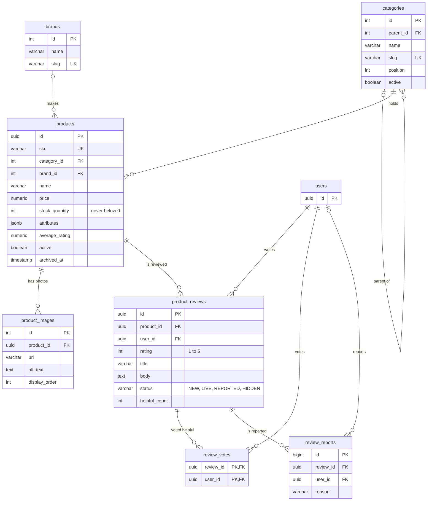
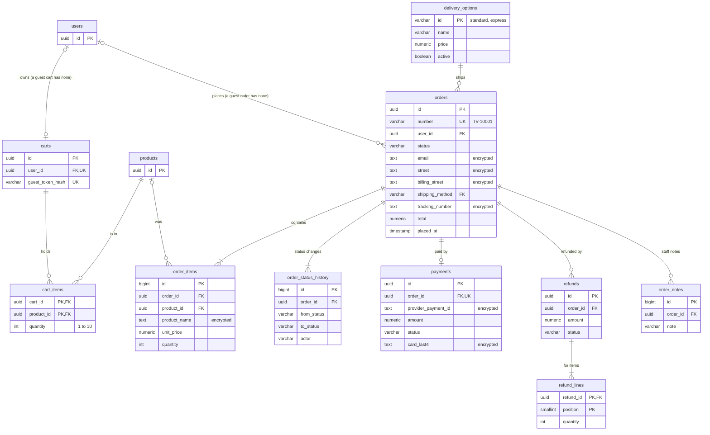
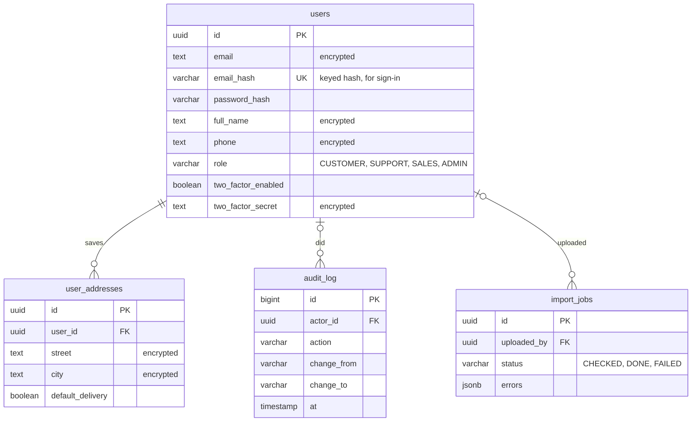

# How Tavla works

The technical detail behind the [README](../README.md). Each feature's file is mapped in
[backend/README.md](../backend/README.md) and [frontend/README.md](../frontend/README.md).

## Contents

1. [Overview](#overview)
2. [Login and sessions](#login-and-sessions)
3. [Search](#search)
4. [Cart, orders and payments](#cart-orders-and-payments)
5. [Staff area](#staff-area)
6. [Security](#security)
7. [Images and search engines](#images-and-search-engines)
8. [Database](#database)

---

## Overview

| Part | Technology |
|---|---|
| Website | React 18, TypeScript, Vite. Redux Toolkit and React Query for state, Axios for requests, Stripe.js for the card form |
| Server | Java 21, Spring Boot 4, Spring Security, stripe-java |
| Database | PostgreSQL 16, with the schema managed by Flyway |
| Sessions and rate limits | Redis 7 |
| Message queue | RabbitMQ 4 |
| Email (development) | MailHog |
| Payments | Stripe (test mode), with the Stripe CLI forwarding its webhooks |
| Everything runs in | Docker Compose: 7 containers (website, server, database, Redis, RabbitMQ, MailHog, Stripe CLI) |

The server is one application split into areas: users, login, catalog, cart, orders, payments, delivery,
audit, overview and support. Each area talks to the others only through a small interface.

### Where the product data comes from

The products are real listings from three chess, Go and
backgammon suppliers. A few **Python scripts** in [tools/catalog-import](../tools/catalog-import/README.md)
download the suppliers' product pages and turn them into one SQL file, which the database loads on
startup. The scripts are a one-off tool the developer runs by hand, not part of the shop, and the
finished SQL file is committed, so **you don't need Python to run the project**.

---

## Login and sessions

**Login tokens (JWT).** Logging in returns two tokens. The *access token* is a signed JWT (library:
jjwt) that lasts 15 minutes and holds only the user id and role, no personal data. The website keeps
it in memory only, never in browser storage. The *refresh token* lasts 7 days and sits in an
`httpOnly` cookie that JavaScript can't read. After a page reload, the website uses the refresh
token to get a new access token.

**Single-use refresh tokens.** Every refresh swaps the old refresh token for a new one in Redis in
one atomic step (a small Lua script), so the same token can never be used twice, even by two
requests at the same moment.

**Logout.** The access token's id goes on a blocklist in Redis until the token would have expired
anyway, and the refresh token is deleted.

**Two-factor login (TOTP).** The standard authenticator-app method (library: `dev.samstevens.totp`).
The server creates a secret, the website shows it as a QR code, and the app then shows a new 6-digit
code every 30 seconds. After 2FA is on, logging in takes the password *and* a current code.

**CAPTCHA.** Google reCAPTCHA on sign-up. The server checks the CAPTCHA token with Google before
creating the account.

**Google login.** The website gets an ID token from Google, and the server checks that token's
signature against Google's public keys before logging the user in.

**Password reset.** The server emails a one-time link that expires. Using it sets the new password
and logs the account out everywhere.

**Validation.** Forms are checked in the browser for quick feedback, and every request is checked
again on the server, because the browser checks can be bypassed.

**Image upload.** The server checks the file's actual contents, not its name, to confirm it's a
JPEG or PNG. It then re-saves the image, which strips anything hidden inside it, and stores it under
a random name.

---

## Search

Search uses PostgreSQL's built-in full-text search, so no separate search engine is needed.

- **Matching.** Every product has a pre-built search index made from its name, description and
  attributes (such as wood type). A match in the name ranks above a match in the description.
- **Typos.** If nothing matches exactly, the search falls back to "similar-looking" names
  (the `pg_trgm` extension), so `stanton` still finds Staunton sets. The page says when it did this.
- **Filters.** Results can be narrowed by category, brand, price range and rating. Each filter shows
  how many results it would leave.
- **Sorting.** By relevance, price, rating or newest.
- **Suggestions.** Product names appear while you type, from 2 characters on.
- **Speed.** Indexes keep searches fast. They were tested on 50,000 products.

Search is behind one interface in the code, so it can be swapped for a dedicated search engine
(such as Elasticsearch) later without changing anything else.

---

## Cart, orders and payments

**The cart.** A guest's cart is found by a random token in a cookie JavaScript can't read; the
database keeps only a hash of it. A logged-in shopper's cart belongs to their account. Prices are
never stored in the cart: they are read from the products every time, so the cart can't show an old
price.

**Placing an order.** In one database transaction the server takes the stock for every item, copies
the cart into the order, and empties those lines from the cart. Stock is taken with a single
"take it only if there's enough" update, so when two people buy the last item at the same moment,
exactly one succeeds and the other is told it sold out. If any item is short, the whole order is
undone.

**Paying (Stripe).** The server asks Stripe for a payment for the order's total. The browser shows
Stripe's card form, which sends the card straight to Stripe, and Stripe tells our server the result
by calling its webhook. The server checks that call's signature, so a fake "paid" message is
rejected. If the webhook is lost, a job that runs every minute asks Stripe directly before releasing
an unpaid order's items.

**The message queue.** The webhook only checks the signature, puts the payment's result on a RabbitMQ
queue and answers Stripe at once. A separate listener takes it off the queue and, in one database
transaction, updates the order, its stock and its history. Each Stripe message is applied once, even
if it arrives twice. If applying it fails, it is retried twice more; after that it is moved to a
*dead letter queue*, where it waits to be looked at and moved back, instead of being lost or retried
forever.

**Emails.** Only after that transaction has saved does the server put "this order needs an email" on a
second queue, so nobody gets an email about a change that didn't happen. A second listener writes the
email from the order and sends it. If the mail server is down, the email is retried and then waits in
its own dead letter queue, while payments carry on.

**Cancelling and refunds.** A paid order can be cancelled until packing starts. In one transaction the
order becomes *Cancelled* and its stock goes back on sale; then the server asks Stripe for the refund.
When Stripe confirms it, the order becomes *Refunded*. If Stripe can't be reached, the order stays
cancelled and a job asks Stripe again every minute. Each refund is sent with the order's own id as a
key, so asking twice never refunds twice.

---

## Staff area

**Roles and two-factor.** One table in the server (`auth/StaffArea.java`) says which role may use which
area. Every admin request is checked against it, and also needs a session that gave a 2FA code. Changing
someone's role ends their open sessions, so the new role applies at once.

**Audit log.** Every staff change and sign-in writes a row: who, what, before and after. A database trigger
refuses any edit or delete for 12 months, so not even the server can rewrite history.

**Bulk upload.** The file is checked row by row against the same rules as the product form, without changing
anything. Confirming imports every row in one database transaction: all or nothing.

---

## Security

**Encryption.** Personal and payment details are encrypted with AES-256-GCM before they're saved; a changed
byte is detected instead of decrypted to nonsense. An encrypted email can't be searched, so the database
also keeps a keyed hash of it, which is what sign-in looks up. The key comes from `.env`.

**Rate limits (token buckets).** Each address gets a bucket of tokens per action in Redis (sign-in: 10,
refilled one every 6 seconds). A request takes a token; an empty bucket answers 429 with how long to wait.

---

## Images and search engines

**Images.** An uploaded photo is saved at its own size plus 160, 600 and 1200 px wide, and the browser picks
the smallest that is sharp enough. nginx serves them with a year-long cache. In production a CDN would sit in
front; a photo's name changes whenever it does, so nothing cached is ever stale.

**Search engines.** Each page sets its own title and description, products have readable addresses, and
pages use real headings, lists, navigation and buttons, which also helps screen readers.

---

## Database

PostgreSQL. The tables are created on startup by numbered migration files in
`backend/src/main/resources/db/migration` (`V1` to `V16`). The diagram is split in three so it stays
readable; `users`, `products` and `orders` appear in more than one, with only their key. *Encrypted* marks
columns stored scrambled.

**Catalog and reviews**

**Cart, orders and payments**

**Accounts and staff**

| Table | Holds |
|---|---|
| `categories`, `brands` | The category tree (each can have a parent) and the brands |
| `products`, `product_images` | Products with price, stock, weight and size in both unit systems, and their photos |
| `product_reviews`, `review_votes`, `review_reports` | Reviews (1–5 stars and text), one "helpful" vote per shopper, and reports waiting for staff |
| `users`, `user_addresses` | Accounts (personal columns encrypted) and up to 10 saved addresses each |
| `carts`, `cart_items` | One cart per account or per guest. No prices: they're read fresh from `products` |
| `orders`, `order_items`, `order_status_history` | An order, a copy of what was bought, and every status change |
| `payments`, `refunds`, `refund_lines` | The Stripe payment behind an order, and whole or part refunds |
| `delivery_options`, `shop_settings` | Delivery options staff can edit, and the free-shipping limit |
| `order_notes`, `audit_log`, `import_jobs` | Staff notes on orders, the uneditable log of staff actions, and bulk uploads |
| `processed_payment_events` | Stripe messages already handled, so one sent twice is applied once |

Order statuses and who may move them: [claude-docs/ORDER_STATES.md](../claude-docs/ORDER_STATES.md). Ids,
statuses, dates and money stay readable, because the database filters and sorts on them.
